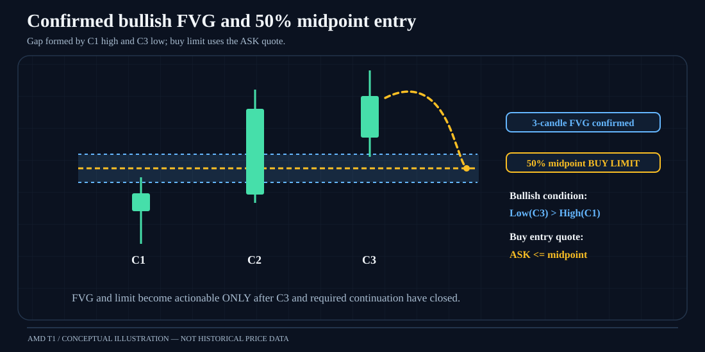
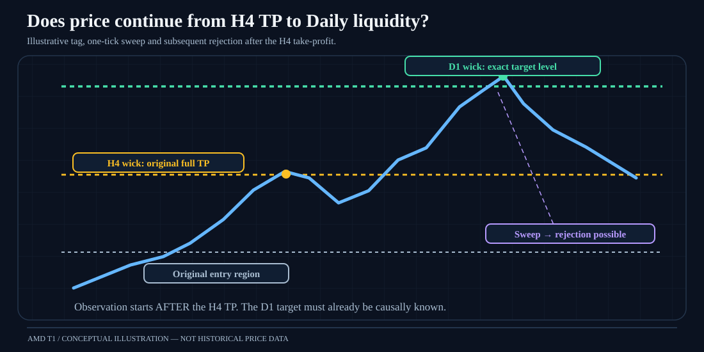

# AMD — Accumulation, Manipulation & Distribution / T1 Research

A documented research project studying **GBPUSD H1 consolidation → close breakout → directional continuation → three-candle Fair Value Gap (FVG) → pending limit at the 50% gap midpoint**, using historical bid/ask quotes, H4/D1 structural context, and three frozen alternative range detectors.

> **Research, not live-trading software or financial advice.** This repository records historical experimental evidence, provisional assumptions, defects uncovered, and unfinished validation. Positive gross backtests do **not** prove that any variant is robustly profitable after realistic costs or portfolio constraints.

**Earlier research status (Phase 6, 27 October 2026):** all 1,099 corrected A/B/C midpoint-order records were scanned against historical GBPUSD ticks; 717 recorded correct-side price reaches. The subsequent SL×TP study found positive gross historical H4/SL2 results. **Phase 6** then simulated commissions, slippage, dynamic 0.5%-equity risk and one-position portfolios, reporting positive modeled net outcomes across A/B/C. However, swaps remain zero, commission/slippage are hypothetical, pending-order competition is incomplete, and the 2023 data gap is unresolved. Equity drawdown, broker-specific net returns, independent holdout and live performance are still unverified.

## Three detection variants

| Variant | Philosophy | H1 range records | Corrected eligible orders | 12h FVG midpoint price reaches |
|---|---|---:|---:|---:|
| **A — canonical** | Original rule-based consolidation detector | 365 independent | 239 | 158 / 239 (66.1%) |
| **B — extreme wicks** | Outer wick highs/lows plus chop; causal frozen boundaries | 2,322 raw; 600 representatives | 361 | 224 / 361 (62.0%) |
| **C — defended levels** | Repeated reaction levels; isolated outlier wicks are sweeps, not automatically new boundaries | 1,705 H1; 819 H4 | 499 | 335 / 499 (67.1%) |

The **current primary research variant is Detector C**; retain A and B as independently evaluated alternative branches, not discarded prototypes. 717 is a detector-associated count; some entry opportunities can overlap across detectors. None of the percentages is a trade win rate.

## Latest research milestone — 27 October 2026

**Phase 8.3 full quote replay** was reported across **128,332,195 GBPUSD tick rows**, comparing frozen M0–M5. Original **M0 H4 full exit** retained the highest modeled five-year net profit (**+$1,340.29**, **PF 3.401**, **86.11% net WR**, **+0.1803R/trade**), but these remain **provisional research simulations**, not broker-verified or forward-tested returns. Frozen D1 runner models did not outperform M0 in modeled net dollars. The EURUSD 2021 one-year holdout remains **unrun** because the independently portable frozen Detector C/Scenario A-B/FVG signal generator has not been recovered or proven GBPUSD event-level equivalent.

**[Latest release notes](docs/20-release-notes-2026-10-27.md)** · [Phase 7 audited D1 study](docs/16-phase7-h4-d1-continuation-audit.md) · [Phase 8.3 model table](docs/18-phase8-3-full-tick-results.md) · [EURUSD portability blocker](docs/19-eurusd-2021-portability-blocker.md)

The historic **Phase 6 $1,284.03** row below is retained as a separately scoped earlier simulation, **not** superseded or silently recomputed.

## Navigation

- [Research overview and provenance](docs/00-overview.md)
- [Exact strategy and causal signal specification](docs/01-strategy-specification.md)
- [Detector A/B/C internals and differences](docs/02-range-detectors.md)
- [FVG geometry, quote-side fills and execution](docs/03-fvg-execution.md)
- [Stop-loss, liquidity TP and provisional lifecycle](docs/04-sl-tp-management.md)
- [Detailed chronological experimental log — Phase 1 to SL/TP](docs/05-experiment-timeline.md)
- [Historical entry validation and reconciliations](docs/06-entry-results.md)
- [Trade-management backtest results, full caveats](docs/07-sl-tp-results.md)
- [Data, timestamping and source coverage](docs/08-data-provenance.md)
- [Limitations, integrity flags and false conclusions to avoid](docs/09-limitations.md)
- [Reproduction requirements and local artifact manifest](docs/10-reproduction.md)
- [**Visual diagram gallery — seven illustrated SVG trading examples**](docs/15-visual-diagram-gallery.md)
- [Mermaid diagrams and annotated manual chart interpretations](docs/11-diagrams-and-examples.md)
- [Open research questions, release gates and next steps](docs/12-open-questions.md)
- [Migration checklist: unpublished local source, charts and ledgers](docs/13-artifact-migration.md)
- [**Phase 6: modeled transaction costs, sizing and one-position portfolio (October 2026)**](docs/14-phase6-cost-portfolio.md)
- [Phase 6 base-cost A/B/C SL2/H4 summary CSV](data/summary/phase6-base-sl2-h4.csv)
- [Detector C SL2/H4 monthly trade counts, 2021-02 to 2025-12](data/summary/monthly-h4-sl2-trade-counts.csv)

## Visual strategy diagrams

The illustrated examples shown during development are available as **real SVG image files**, viewable directly in GitHub—not just text diagrams. They are deliberately schematic and do not represent price data.

See the [full seven-image gallery](docs/15-visual-diagram-gallery.md), including Detector C wick sweeps, both stops, Scenario A/B, long/short quote sides and the 2R comparison illustration.

## Headline provisional 72h H4-liquidity results

These are **backtest trades with valid stop + eligible target**, not all 717 midpoint reaches.

| Detector | Stop | H4-TP trades | TP | SL | Avg realized R | PF | Reported max drawdown |
|---|---|---:|---:|---:|---:|---:|---:|
| A | SL1 midpoint between FVG edge and swing/sweep | 141 | 101 | 40 | +0.009 | 1.028 | −8.91R |
| A | SL2 beyond swing/sweep + buffer | 141 | 132 | 9 | +0.210 | 4.209 | −2.00R |
| B | SL1 | 190 | 142 | 48 | +0.037 | 1.128 | −14.09R |
| B | SL2 | 189 | 177 | 12 | +0.169 | 3.610 | −2.81R |
| C | SL1 | 301 | 200 | 101 | +0.000 | 1.001 | −27.96R |
| C | SL2 | 299 | 277 | 22 | +0.195 | 3.612 | −3.76R |

**Important:** SL2 is much wider, so a high TP-hit ratio does not imply large reward per unit risk. The historical H4/SL2 means are positive but not broker-cost-adjusted production expectancy; reported absence of time exits in these selected H4 rows warrants checking. Refer to [full caveats](docs/09-limitations.md).

## Phase 6 — hypothetical cost-adjusted portfolio results (SL2 + H4 TP)

Reported with a $5,000 initial USD account, 0.5% equity risk sizing and one-position mode. Commission and adverse execution slippage were modeled using **assumed** cost profiles; swaps were zero because broker history was unavailable.

| Detector | Net portfolio trades | Net USD P&L | Account return | Modeled net PF | Average net R | **Balance** DD | Ending balance |
|---|---:|---:|---:|---:|---:|---:|---:|
| A | 140 | +$595.14 | +11.90% | 3.630 | +0.188 | $50.26 | $5,595.14 |
| B | 189 | +$647.55 | +12.95% | 3.117 | +0.149 | $73.59 | $5,647.55 |
| **C** | **296** | **+$1,284.03** | **+25.68%** | **3.200** | **+0.174** | **$101.08** | **$6,284.03** |

**These are conditional historical simulations, not verified realized returns**: zero swap, no true broker cost schedule, mark-to-market equity drawdown not reported, one-position filtering applied only to completed-entry opportunities, and unresolved 2023 quote-source gap. Full context: [Phase 6 report](docs/14-phase6-cost-portfolio.md).

## Architecture at a glance

~~~mermaid
flowchart TD
    T[HistData GBPUSD bid/ask ticks] --> C[Construct completed H1 / H4 / D1 candles]
    C --> A[Detector A canonical]
    C --> B[Detector B extreme-wick/chop]
    C --> D[Detector C defended reaction levels]
    A --> E[Shared causal close-breakout & Scenario A/B engine]
    B --> E
    D --> E
    E --> F[Completed 3-candle FVG]
    F --> G[50% FVG BUY/SELL LIMIT eligibility]
    G --> H[Chronological historical bid/ask price-reach replay]
    H --> I[SL1 and SL2 paired evaluation]
    C --> J[Confirmed H4/D1 swing liquidity levels]
    J --> K[H4 / D1 / nearest HTF wick TP]
    I --> L[Paired chronological tick exits]
    K --> L
    L --> M[Trade ledger / R / PF / DD / monthly evidence]
~~~

## What is and is not in this repository

This publication documents the strategy, design hypotheses, audits, diagrams, user-defined discretionary rules, historical reported metrics, source file inventory, and an independently reconstructed monthly-count table from CSVs supplied in the conversation. It **does not claim to contain the local Windows Python engines, raw 133-million-tick archive collection, Parquet order/trade ledgers, all chart screenshots, or every original phase report**. Those must be imported from the local research working tree before this becomes a completely reproducible code-and-data release. See [migration checklist](docs/13-artifact-migration.md).

## Preservation policy

Never silently modify or overwrite original Detector A/B/C baselines, legacy audit reports, corrected event IDs, or historical raw data. Version new rules and report changes as explicit experiments. Keep GSR and MT5 assets outside this project's scope. No secrets, credentials, account data or raw large tick ZIPs in Git history.
