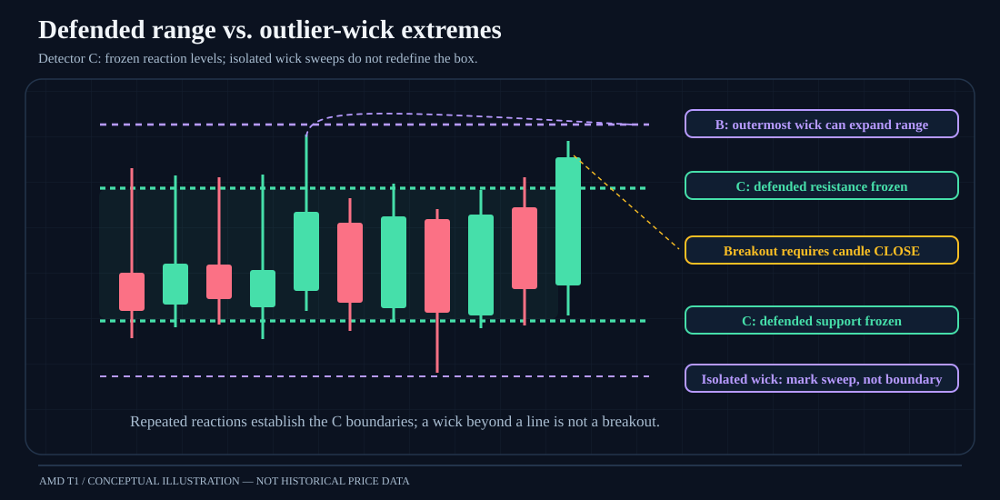
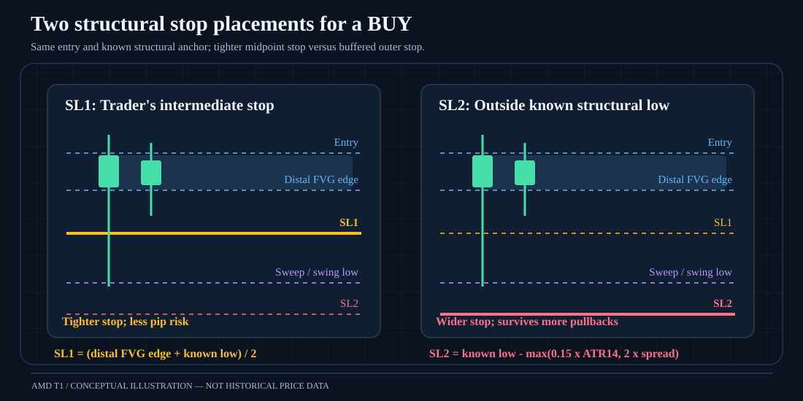
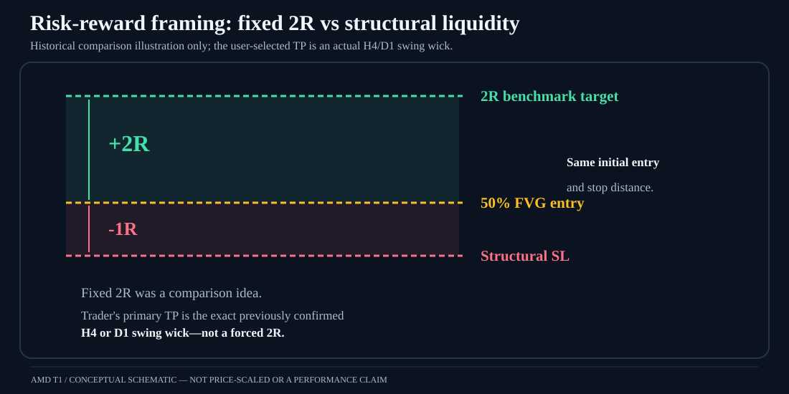
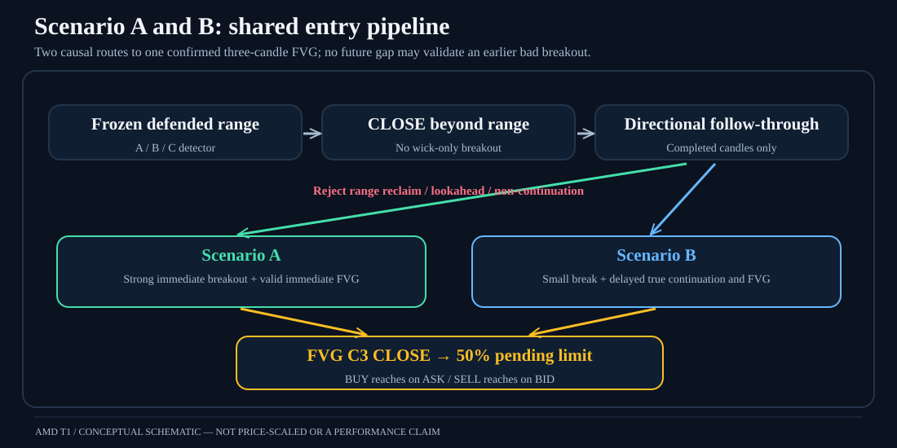
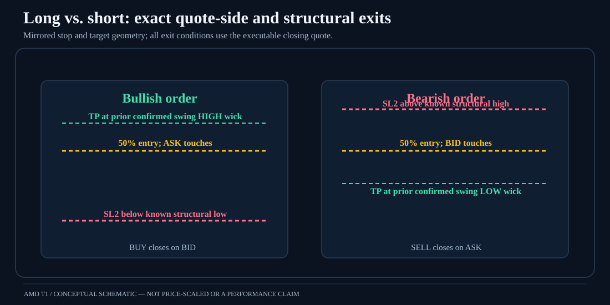

# AMD T1 — Visual strategy diagram gallery

These **seven standalone, GitHub-renderable SVG illustrations** reproduce the kind of conceptual diagrams used while designing this research. Unlike the previous text diagrams, they are actual visual files stored at `docs/assets/` and can be viewed in GitHub, downloaded as standalone SVGs, or linked from a report.

> **Conceptual illustrations only** — not screenshots of the HistData feed, user-supplied historical charts, recorded trades, or fitted numerical charts. Geometry and price-path shapes are examples. No performance numbers are implied.

## 1. Detector C: defended range versus extreme wicks

[View the standalone SVG](assets/01-defended-range-and-sweeps.svg)

A repeated reaction boundary can be more structurally meaningful than the single highest or lowest outlier wick. **Detector C** preserves a confirmed defended line after a wick pierces and closes back inside (record as a sweep); Detector B's extreme-wick style may expand the line. A breakout candidate needs a **completed directional candle close beyond the frozen range**, not merely a wick.

## 2. Three-candle bullish FVG and midpoint limit

[View the standalone SVG](assets/02-three-candle-fvg-and-midpoint.svg)

For bullish C1/C2/C3: `Low(C3) > High(C1)`. The gap spans `High(C1)` to `Low(C3)`; its midpoint is the limit price. For shorts use the reversed inequality and mirrored price region. The order can activate only after **C3 and scenario confirmation closes**; the buy limit is tested against **ASK**, and sell limit against **BID**.

## 3. Side-by-side stop-loss placements

[View the standalone SVG](assets/03-stop-loss-comparison.svg)

For a long trade with distal bullish FVG lower edge `F` and causally known structural/sweep low `S`, initial experiments set `SL1 = (F + S) / 2` and `SL2 = S - max(0.15 * ATR14(H1), 2 * activation spread)`. Short-side formulas are mirrored. Stop anchors must have been knowable at entry; missing anchors are excluded and reported. SL2 is wider and cannot be judged only by fewer stop hits.

## 4. H4 take-profit → D1 swing liquidity continuation

[View the standalone SVG](assets/04-h4-to-d1-liquidity-continuation.svg)

This is the **current Phase 7 research hypothesis**, *not a measured result*. After an original **H4 take-profit at the exact confirmed swing wick**, some trades might progress to a **previously confirmed D1 swing-wick high** (for longs) or low (for shorts). Distinguish:
- **Tag:** correct-side executable exit quote equals or passes that level.
- **Sweep:** price moves **at least one tick** beyond the level (not merely touches it).
- **Rejection:** later completed H1 candle closes back through the level.
- **Continuation:** price remains beyond it or travels farther, with adverse retracement analyzed separately.

The diagram illustrates one possible path; nothing in it establishes that tag/sweep/rejection frequencies are favorable. The D1 level should be known at the selection timestamp; no future chart hindsight.

## 5. The 2R explanatory example — not the preferred target

[View the standalone SVG](assets/05-risk-reward-2r-benchmark.svg)

Earlier discussion compared a fixed **+2R** target to a **−1R** initial structural stop. This was an explanatory/baseline idea. The trader explicitly selected **the exact previously confirmed H4/D1 wick** for the primary TP, even if the available reward is only a fraction of the planned risk.

## 6. Scenario A vs Scenario B decision pathways

[View the standalone SVG](assets/06-scenario-a-and-b-flow.svg)

Scenario A uses immediate strong displacement and a qualifying gap; Scenario B allows a smaller first break followed by **genuine delayed continuation** and gap *before reclaim*. The original C Scenario B audit rejected **1,105 of 1,504** provisional records. A future gap alone may not retroactively validate the breakout.

## 7. Mirrored BUY and SELL price/quote-side exits

[View the standalone SVG](assets/07-buy-vs-sell-exit-levels.svg)

For long orders, use **ASK** to fill the buy limit and **BID** for TP and SL on the closing sell. For shorts, use **BID** to fill the sell limit and **ASK** to close. This keeps spread represented exactly once.

---

### Authentic screenshot status and contribution notes

These illustrations are **not copies** of the trader's uploaded chart screenshot(s). The genuine trade/drawing screenshots—including the intermediate SL between FVG and sweep—have not yet been copied from local assets into this repository. When approved and accessible, add the originals under `docs/assets/screenshots/` with source symbol, timeframe, timestamp and privacy review; do not replace these concept SVGs or mislabel them as actual market-data images.

This gallery documents **visual strategy concepts only**, per the trader's request. No Phase 7 scan results or runner strategy changes have been added.
